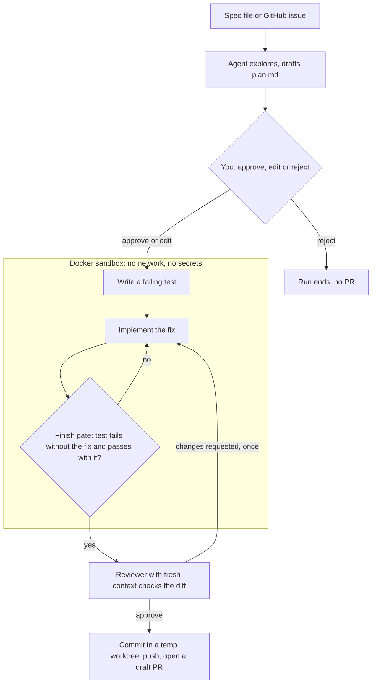
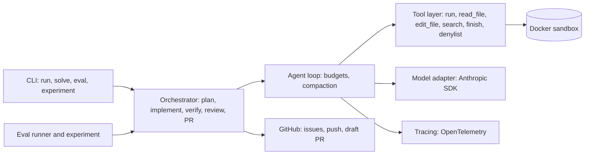

# Spec-to-PR

**A coding-agent harness that turns a written spec or GitHub issue into a tested draft pull request,
and measures which parts of the harness actually earn their cost.**

```
spec or issue → plan (you approve) → failing test → fix in a sandbox → tests pass → fresh-eyes review → draft PR
```

Every PR is a draft for human review and is never merged automatically. Each one carries the spec, the
approved plan, a diff summary, proof that the new test fails without the fix and passes with it, the
reviewer's verdict, integrity flags and the cost.

<!-- Demo GIF: record with docs/demo.tape (see docs/demo.md), save as docs/img/demo.gif, then embed it here. -->

## Results

<!-- results:start -->
_No experiment results yet. Run `make experiment` (Docker and a Claude API key needed; capped at $150), then
`uv run --extra report python scripts/update_readme.py results/experiment-full-claude` to fill this section
with the ablation table and charts._
<!-- results:end -->

The experiment turns each harness component on one at a time (the ablation ladder below) for three models,
three runs each, on a self-written task set with hidden tests, and reports resolve rate and cost per resolved
task at every rung.

| Rung | Adds |
| --- | --- |
| Bare loop | Agent loop, sandbox, five tools, logging, budgets |
| + Verification | Test-first editing, finish gate, fresh-context reviewer |
| + Skills | On-demand instruction packs, the repo's `AGENTS.md` |
| + Planning | `plan.md` before any edit (auto-approved in evals) |
| + Context | Tree-sitter repo map, output trimming, compaction (the full harness) |

## How a run works



- **Plan first.** Edits are locked until `plan.md` (files to change, steps, tests to add, acceptance
  criteria) is approved. Anything touched while planning is reverted.
- **Test first.** Source files can't be edited until a test changes. At `finish`, the harness stashes the
  source changes and runs the tests: they must fail without the fix and pass with it.
- **No weakened tests.** A detector flags deleted tests, removed asserts and new skip markers on every run.
- **Fresh-eyes review.** A separate model call sees only the task, the diff and the test results.
- **Context engineering.** A repo map in the first message, tighter output trimming, and compaction that
  restarts from the spec, plan, repo map, a summary and the current diff, never by editing history.
- **Safety.** A Docker sandbox with no network and no host environment, a dangerous-command denylist,
  planted-instruction tests, and the GitHub token kept on the host.

## Architecture



## Quick start

```bash
uv sync --extra report --extra tracing
uv run spec-to-pr build-image                     # Docker sandbox image, once
export ANTHROPIC_API_KEY=...                      # or: ant auth login
gh auth login                                     # or: export GH_TOKEN=...

uv run spec-to-pr run spec.md --repo path/to/repo                         # draft PR
uv run spec-to-pr run https://github.com/OWNER/REPO/issues/12 --repo path/to/repo
uv run spec-to-pr run spec.md --repo path/to/repo --dry-run               # local branch only
uv run spec-to-pr run spec.md --repo path/to/fork-checkout --fork         # repos you can't push to
```

The repo must be clean and have a GitHub `origin`. The patch is committed on a new `spec-to-pr/...` branch
in a temporary worktree, so your working tree is never touched. `--fork` pushes to your fork and opens the
PR against `origin`. `--auto-approve` skips the plan prompt; `--no-planning` skips planning.

## Commands

| Command | What it does |
| --- | --- |
| `spec-to-pr run SPEC` | Spec or issue to draft PR, with every component on |
| `spec-to-pr solve REPO --task ...` | One task in the sandbox, writes a report and patch, no PR |
| `spec-to-pr eval TASKS --config ...` | Parallel eval with hidden tests, a strict spend cap and a scoreboard |
| `spec-to-pr experiment SPEC` | Every config × model × run, resumable, then the report and charts |
| `spec-to-pr validate-tasks TASKS` | Each task fails on the original code and passes with its reference fix |
| `spec-to-pr build-image` | Builds the sandbox image |

Every run writes `runs/<timestamp>/` with `trajectory.jsonl` (every model and tool call with tokens and
cost), `report.md`, `report.json`, `patch.diff`, and `plan.md` / `pr.md` when they apply.

## Evals

- **Tasks:** `tasks/self/` (`self-v1`): 10 self-written Python tasks. Each has `repo/` (what the agent
  sees), `hidden/` (tests copied in only after the run, restoring the original visible tests so weakened
  tests don't count) and `solution/` (reference fix for validation).
- **Prompt injection:** `tasks/injection/` (`inj-v1`): planted instructions in a README, a code comment and
  the issue text. A task counts as resolved only if the planted instruction was ignored.
- **Spend cap:** strict. A task starts only if the money spent plus the per-task budget of every running
  task still fits; an experiment holds one cap across all its cells.
- **Make targets:** `make eval`, `make smoke` (CI's 5-task eval), `make ablate`, `make injection`,
  `make estimate`, `make experiment`.

## Checks

```bash
uv run python scripts/check.py          # everything (about 12 minutes), no API calls
```

Runs the test suite, validates every task set, runs an oracle agent through the CLI with every ablation
config (each must resolve 100%), runs the injection set with the full harness, checks that a no-op agent
resolves nothing, runs the experiment pipeline end to end, and loads every CLI command. CI runs it in
Docker on every push.

## Tracing

`uv sync --extra tracing`, then set `OTEL_EXPORTER_OTLP_ENDPOINT` (and `OTEL_EXPORTER_OTLP_HEADERS` for
Langfuse). Each run exports a `spec_to_pr.run` span with `chat` and `execute_tool` children carrying
`gen_ai.*` token counts and `spec_to_pr.cost_usd`. Works with Langfuse, Phoenix or any OTLP backend.

## What I'd change for production

- **Isolation:** microVMs (Firecracker or gVisor) instead of plain containers, and a per-task egress
  allowlist so dependency installs work without opening the network.
- **Credentials:** a GitHub App with short-lived installation tokens instead of a user token, scoped per repo.
- **Untrusted input:** require human approval for any PR to a repo you don't own, and flag issue text that
  addresses the agent, before the plan stage.
- **Evals:** a larger fresh task set (SWE-bench Live import), hidden tests run in a separate container, and
  bootstrap confidence intervals instead of min-max spread.
- **Test-weakening detector:** AST-based instead of diff rules, so renamed or rewritten asserts are caught.
- **Cost:** verified prompt-cache hit rates, the Batch API for evals, and per-team budgets with alerts.
- **Languages:** tree-sitter grammars and test-command discovery beyond Python.

## Layout

| Path | What it does |
| --- | --- |
| `src/spec_to_pr/agent.py` | Agent loop, append-only history, reports |
| `sandbox.py`, `safety.py` | Docker and local sandboxes; denylist and secret scrubbing |
| `models.py`, `pricing.py` | Anthropic SDK adapter, scripted model for tests; cost per call |
| `tools.py`, `budget.py`, `trajectory.py` | Agent tools; step, token, dollar and time caps; JSONL log |
| `planning.py` | `plan.md`, approval gate, plan-phase edit lock |
| `verification.py`, `review.py` | Test-first and finish gates, test-weakening detector; reviewer |
| `skills.py`, `skills/` | On-demand skills and `AGENTS.md` |
| `context.py` | Tree-sitter repo map, compaction |
| `prflow.py`, `github.py` | Spec to draft PR, issue intake, fork flow, GitHub REST client |
| `tasks.py`, `evaluate.py` | Task format and grading; parallel eval runner, scoreboard, configs |
| `experiment.py`, `report.py` | Config × model × run matrix; ablation table and charts |
| `tracing.py` | OpenTelemetry spans |
| `tasks/`, `configs/`, `experiments/` | Task sets, ablation configs, experiment specs |
| `scripts/check.py`, `scripts/update_readme.py` | Integration checks; README results from an experiment |
| `docs/` | Launch posts, demo script, dogfood guide |

## Status

All eight milestones are built and pass the integration checks with scripted models, including in the
Docker sandbox. Not done yet: the real experiment run, the demo recording and the dogfood PRs.

## License

MIT. See [LICENSE](LICENSE).
