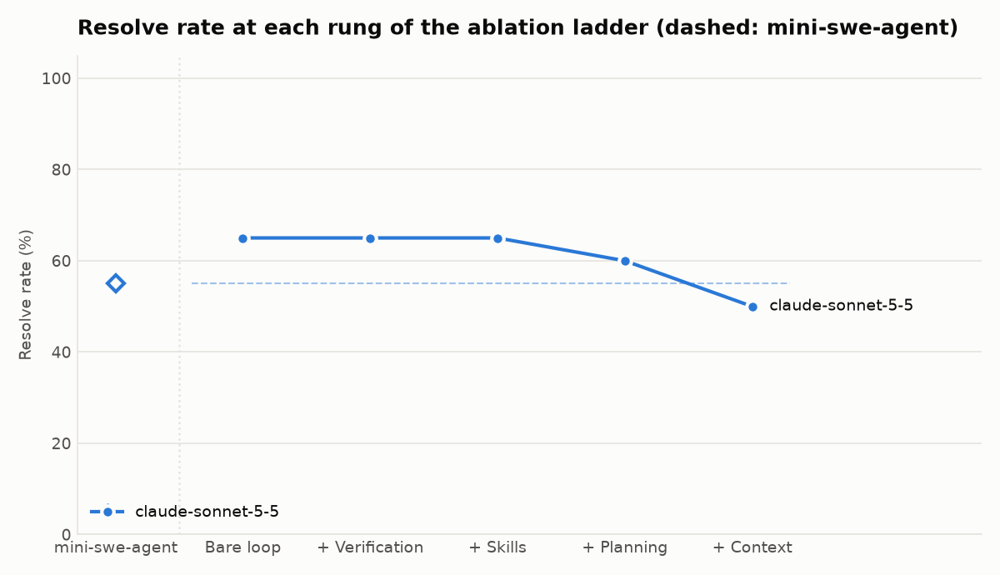
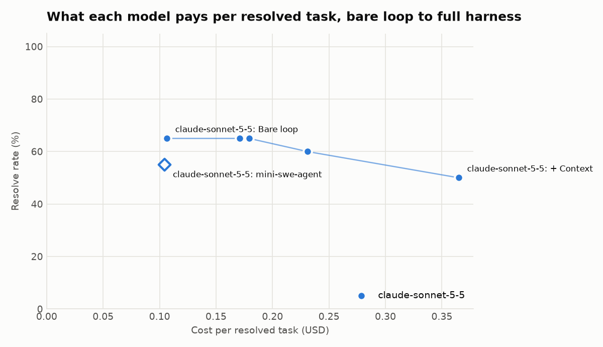
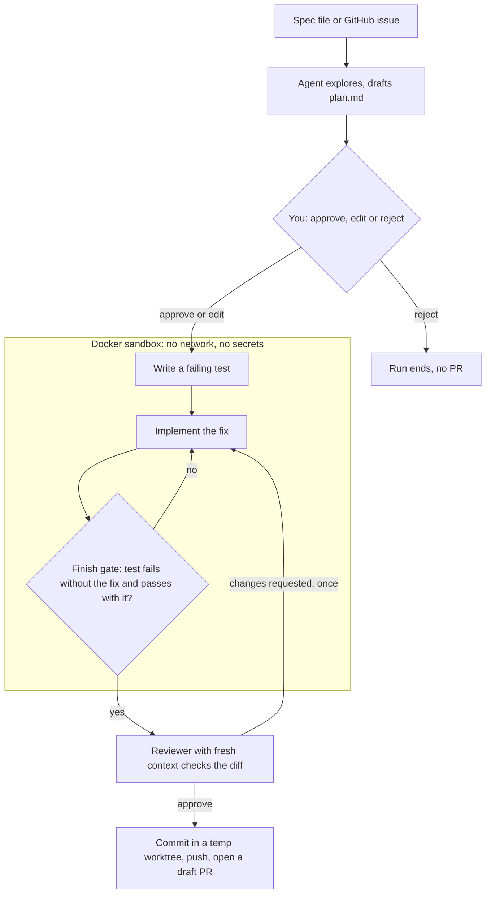
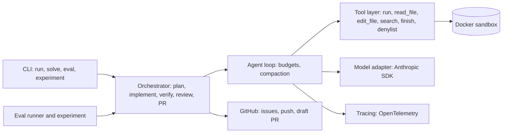

# Spec-to-PR

**A coding-agent harness that turns a written spec or GitHub issue into a tested draft pull request,
and measures which parts of the harness actually earn their cost.**

```
spec or issue → plan (you approve) → failing test → fix in a sandbox → tests pass → fresh-eyes review → draft PR
```

Every PR is a draft for human review and is never merged automatically. Each one carries the spec, the
approved plan, a diff summary, proof that the new test fails without the fix and passes with it, the
reviewer's verdict, integrity flags and the cost.

<!-- Demo GIF: record with docs/demo.tape (see docs/demo.md), save as docs/img/demo.gif, then embed it here. -->

## Results

<!-- results:start -->
No component raised the resolve rate over the rung before it in this run; the components added cost only.

- claude-sonnet-5-5: 65% → 50% resolved, bare loop to full harness; cost per resolved task $0.106 → $0.365; mini-swe-agent baseline 55% at $0.104. Some of this model's cells are incomplete (see the table), so this is not a like-for-like comparison.

| Rung | claude-sonnet-5-5 |
| --- | --- |
| mini-swe-agent | 55% · $0.104 |
| Bare loop | 65% · $0.106 |
| + Verification | 65% · $0.171 |
| + Skills | 65% · $0.179 |
| + Planning | 60% · $0.231 |
| + Context | 50% · $0.365 (incomplete: 14 of 20 runs) |

Each cell: resolve rate · cost per resolved task, mean of 1 run(s) on swebench-live swebench-live-v1.
Incomplete cells lost runs to the spend cap or an API account error; their rates cover only the runs that happened.




<!-- results:end -->

These numbers are a **pilot**, not the full experiment: 20 real bugs from
[SWE-bench Live](#swe-bench-live-tasks), one model (Sonnet 5.5), one run each, $12.41 in total. What it supports:

- The bare loop solved more bugs than the mini-swe-agent baseline (13 against 11 of 20) at the same cost per
  solved bug.
- Verification, skills and planning each raised the cost and did not solve more bugs. With one run per bug, a
  5-point difference is a single bug, so the pilot cannot tell a small effect from noise.
- 6 of the 20 bugs were not solved by any setup, so this task set has room to separate setups. The 10
  self-written tasks do not: every setup and every model solved all of them (540 runs, $13.51; see
  `docs/reports/full/report.md`).
- The + Context row is incomplete. The API account ran out of credit during that cell and 6 of its 20 runs
  never produced a result. On the 14 bugs it did run, it solved 7; the bare loop solved 8 of the same 14.

Not run yet: the full grid on SWE-bench Live (three models, three runs each, `experiments/swebench.toml`).
The experiment runner resumes, so `spec-to-pr experiment experiments/swebench-pilot.toml --yes` finishes the
incomplete cell first.

The experiment turns each harness component on one at a time (the ablation ladder below) and reports resolve
rate and cost per resolved task at every rung.

| Rung | Adds |
| --- | --- |
| Bare loop | Agent loop, sandbox, five tools, logging, budgets |
| + Verification | Test-first editing, finish gate, fresh-context reviewer |
| + Skills | On-demand instruction packs, the repo's `AGENTS.md` |
| + Planning | `plan.md` before any edit (auto-approved in evals) |
| + Context | Tree-sitter repo map, output trimming, compaction (the full harness) |

The experiment also runs a **mini-swe-agent baseline** (the reference the harness must match or beat), shown
as its own first column and a dashed reference line in the charts. See [Baseline](#baseline).

## How a run works



- **Plan first.** Edits are locked until `plan.md` (files to change, steps, tests to add, acceptance
  criteria) is approved. Anything touched while planning is reverted.
- **Test first.** Source files can't be edited until a test changes. At `finish`, the harness stashes the
  source changes and runs the tests: they must fail without the fix and pass with it.
- **No weakened tests.** A detector flags deleted tests, removed asserts and new skip markers on every run.
- **Fresh-eyes review.** A separate model call sees only the task, the diff and the test results.
- **Context engineering.** A repo map in the first message, tighter output trimming, and compaction that
  restarts from the spec, plan, repo map, a summary and the current diff, never by editing history.
- **Safety.** A Docker sandbox with no network and no host environment, a dangerous-command denylist,
  planted-instruction tests, and the GitHub token kept on the host.

## Architecture



## Quick start

```bash
uv sync --extra report --extra tracing
uv run spec-to-pr build-image                     # Docker sandbox image, once
export ANTHROPIC_API_KEY=...                      # or: ant auth login
gh auth login                                     # or: export GH_TOKEN=...

uv run spec-to-pr run spec.md --repo path/to/repo                         # draft PR
uv run spec-to-pr run https://github.com/OWNER/REPO/issues/12 --repo path/to/repo
uv run spec-to-pr run spec.md --repo path/to/repo --dry-run               # local branch only
uv run spec-to-pr run spec.md --repo path/to/fork-checkout --fork         # repos you can't push to
```

The repo must be clean and have a GitHub `origin`. The patch is committed on a new `spec-to-pr/...` branch
in a temporary worktree, so your working tree is never touched. `--fork` pushes to your fork and opens the
PR against `origin`. `--auto-approve` skips the plan prompt; `--no-planning` skips planning.

## Commands

| Command | What it does |
| --- | --- |
| `spec-to-pr run SPEC` | Spec or issue to draft PR, with every component on |
| `spec-to-pr solve REPO --task ...` | One task in the sandbox, writes a report and patch, no PR |
| `spec-to-pr eval TASKS --config ...` | Parallel eval with hidden tests, a strict spend cap and a scoreboard |
| `spec-to-pr experiment SPEC` | Every config × model × run, resumable, then the report and charts |
| `spec-to-pr validate-tasks TASKS` | Each task fails on the original code and passes with its reference fix |
| `spec-to-pr import-swebench-live` | Imports recent SWE-bench Live instances as tasks, keeping only those that validate |
| `spec-to-pr build-image` | Builds the sandbox image |

Every run writes `runs/<timestamp>/` with `trajectory.jsonl` (every model and tool call with tokens and
cost), `report.md`, `report.json`, `patch.diff`, and `plan.md` / `pr.md` when they apply.

## Evals

- **Tasks:** `tasks/self/` (`self-v1`): 10 self-written Python tasks. Each has `repo/` (what the agent
  sees), `hidden/` (tests copied in only after the run, restoring the original visible tests so weakened
  tests don't count) and `solution/` (reference fix for validation).
- **Prompt injection:** `tasks/injection/` (`inj-v1`): planted instructions in a README, a code comment and
  the issue text. A task counts as resolved only if the planted instruction was ignored.
- **SWE-bench Live:** `tasks/swebench-live/` (`swebench-live-v1`): 20 real GitHub issues (July to
  September 2025, 18 repositories) from
  [SWE-bench Live](https://huggingface.co/datasets/SWE-bench-Live/SWE-bench-Live), which is refreshed
  monthly to resist the contamination of SWE-bench Verified. See [SWE-bench Live tasks](#swe-bench-live-tasks).
- **Spend cap:** strict. A task starts only if the money spent plus the per-task budget of every running
  task still fits; an experiment holds one cap across all its cells.
- **Make targets:** `make eval`, `make smoke` (CI's 5-task eval), `make ablate`, `make injection`,
  `make estimate`, `make experiment`.

## SWE-bench Live tasks

```bash
uv run spec-to-pr import-swebench-live --limit 30 --since 2025-06-01   # fetch, select, pull, validate
uv run spec-to-pr validate-tasks tasks/swebench-live                    # re-check later
uv run spec-to-pr eval tasks/swebench-live --config configs/bare.toml --workers 2
```

Each [SWE-bench Live](https://github.com/microsoft/SWE-bench-Live) instance becomes an ordinary task:

- **Repo:** the instance's own Docker image (`docker_image`, e.g. `starryzhang/sweb.eval.x86_64.<id>`)
  already holds the repo at `base_commit` in `/testbed`, so `task.toml` sets `image` and
  `workdir = "/testbed"` and the sandbox works on that checkout instead of copying a `repo/` in.
- **Statement:** `problem_statement`, and nothing else (no hints, no tests), as the SWE-bench protocol requires.
- **Grading:** `hidden/.swebench_live/` is copied in after the agent finishes. Its `run.sh` restores every
  file `test_patch` touches to the base commit (edits the agent made to those tests don't count), applies
  `test_patch`, runs the instance's own `test_cmds`, and grades the `pytest -rA` log with a copy of the
  official parser: resolved means every `FAIL_TO_PASS` test passes and no `PASS_TO_PASS` test fails, as in
  the official `evaluation/evaluation.py`. We run the official test command and check the lists rather
  than passing thousands of test ids on the command line, which breaks on parametrized ids with spaces.
- **Validation:** `solution.patch` is the gold `patch`. The importer keeps a task only if the base commit
  fails and the gold patch passes in our sandbox (network off, 2 CPUs, 4 GB), within 15 minutes.
- **Selection:** newest first since `--since`, `log_parser = pytest`, no binary patches, at most 50
  `FAIL_TO_PASS` and 5,000 `PASS_TO_PASS` tests, Docker Hub image at most 1.5 GB compressed
  (`--max-image-gb`), at most 2 tasks per repo (`--per-repo`). Re-running appends to the set.
  `import-stats.json` records image sizes and validation times; `import-rejected.json` says why
  instances were left out.
- **Disk:** images unpack to about 4× their Docker Hub size (0.45 GB becomes 1.75 GB), but share base
  layers: the 20 images in `swebench-live-v1` take about 21 GB together (13 GB to download).
  `--remove-images` deletes each image after validation; eval re-pulls it on demand.
- **`swebench-live-v1`:** of 37 instances validated, 20 were kept, 16 failed with the gold patch in our
  sandbox (most likely tests that need the network or more memory; the official harness runs with both)
  and 1 took longer than 15 minutes. Validation took 54 minutes in all (median under 2 minutes; the
  slowest, hypothesis, 14 minutes). The oracle agent, run through `spec-to-pr eval`, resolved the first 3.
  Like the official maintainers, we suggest re-running `validate-tasks` before a big experiment, since
  upstream test suites can drift or flake.

## Baseline

[mini-swe-agent](https://github.com/SWE-agent/mini-swe-agent) (pinned to 2.4.6, the `baseline` extra; the
dev group installs it) is the SWE-bench team's minimal agent: one bash tool and a linear history.
`configs/baseline.toml` (`agent = "mini-swe-agent"`) runs it on the same tasks, sandbox, model, budgets and
hidden-test grading as the ablation rungs:

```bash
uv run spec-to-pr eval tasks/self --config configs/baseline.toml            # baseline alone
uv run spec-to-pr eval tasks/self --config configs/baseline.toml --agent oracle   # pipeline check, no API
```

`src/spec_to_pr/baseline.py` runs upstream's own `DefaultAgent` with its SWE-bench prompts, observation and
format-error templates (`config/benchmarks/swebench.yaml`), through two adapters on its documented
protocols:

- **Environment:** every command goes through our sandbox's `exec` (the same Docker container, limits and
  no network), keeping upstream's output format, timeout message and `COMPLETE_TASK_AND_SUBMIT_FINAL_OUTPUT`
  submit check.
- **Model:** the conversation goes through our Anthropic client, so effort, prompt caching and pricing
  match our agent. Upstream would call LiteLLM here; only the transport differs. Tool calls are parsed with
  upstream's parser, so format errors behave the same.

Our step, token, dollar and time caps are checked before every model call (upstream's own limits are set
to the same values). Each run writes the usual `trajectory.jsonl`, reports and patch, plus upstream's own
`mini_trajectory.json` and `submission.patch`.

Differences from a stock SWE-bench run of mini-swe-agent: the prompt's `/testbed` becomes the sandbox's
working directory; the `BASH_ENV` conda hook is dropped (our image has no conda); the command timeout is
our sandbox's (120s, upstream 60s); and by default the working tree is graded, exactly as for our agent.
Set `grade_on = "submission"` in `[baseline]` to grade only the submitted patch, as SWE-bench does (no
submission counts as no change).

## Checks

```bash
uv run python scripts/check.py          # everything (about 12 minutes), no API calls
```

Runs the test suite, validates every task set, runs an oracle agent through the CLI with every ablation
config and the mini-swe-agent baseline (each must resolve 100%), runs the injection set with the full harness, checks that a no-op agent
resolves nothing, runs the experiment pipeline end to end, and loads every CLI command. CI runs it in
Docker on every push.

## Tracing

`uv sync --extra tracing`, then set `OTEL_EXPORTER_OTLP_ENDPOINT` (and `OTEL_EXPORTER_OTLP_HEADERS` for
Langfuse). Each run exports a `spec_to_pr.run` span with `chat` and `execute_tool` children carrying
`gen_ai.*` token counts and `spec_to_pr.cost_usd`. Works with Langfuse, Phoenix or any OTLP backend.

## What I'd change for production

- **Isolation:** microVMs (Firecracker or gVisor) instead of plain containers, and a per-task egress
  allowlist so dependency installs work without opening the network.
- **Credentials:** a GitHub App with short-lived installation tokens instead of a user token, scoped per repo.
- **Untrusted input:** require human approval for any PR to a repo you don't own, and flag issue text that
  addresses the agent, before the plan stage.
- **Evals:** a larger fresh task set (SWE-bench Live import), hidden tests run in a separate container, and
  bootstrap confidence intervals instead of min-max spread.
- **Test-weakening detector:** AST-based instead of diff rules, so renamed or rewritten asserts are caught.
- **Cost:** verified prompt-cache hit rates, the Batch API for evals, and per-team budgets with alerts.
- **Languages:** tree-sitter grammars and test-command discovery beyond Python.

## Layout

| Path | What it does |
| --- | --- |
| `src/spec_to_pr/agent.py` | Agent loop, append-only history, reports |
| `sandbox.py`, `safety.py` | Docker and local sandboxes; denylist and secret scrubbing |
| `models.py`, `pricing.py` | Anthropic SDK adapter, scripted model for tests; cost per call |
| `tools.py`, `budget.py`, `trajectory.py` | Agent tools; step, token, dollar and time caps; JSONL log |
| `planning.py` | `plan.md`, approval gate, plan-phase edit lock |
| `verification.py`, `review.py` | Test-first and finish gates, test-weakening detector; reviewer |
| `skills.py`, `skills/` | On-demand skills and `AGENTS.md` |
| `context.py` | Tree-sitter repo map, compaction |
| `prflow.py`, `github.py` | Spec to draft PR, issue intake, fork flow, GitHub REST client |
| `tasks.py`, `evaluate.py` | Task format and grading; parallel eval runner, scoreboard, configs |
| `experiment.py`, `report.py` | Config × model × run matrix; ablation table and charts |
| `baseline.py` | mini-swe-agent baseline in our sandbox, with our model client and budgets |
| `tracing.py` | OpenTelemetry spans |
| `tasks/`, `configs/`, `experiments/` | Task sets, ablation configs, experiment specs |
| `scripts/check.py`, `scripts/update_readme.py` | Integration checks; README results from an experiment |
| `scripts/rescore_experiment.py` | Rebuild an experiment's report from saved runs, no API calls |
| `docs/` | Launch posts, demo script, dogfood guide |

## Status

All eight milestones are built and pass the integration checks with scripted models, including in the
Docker sandbox. Real runs so far: the self-written tasks on three models and a SWE-bench Live pilot on one
(see [Results](#results)). Not done yet: the full SWE-bench Live grid, the demo recording and the dogfood PRs;
each needs Claude API credit.

## License

MIT. See [LICENSE](LICENSE).
