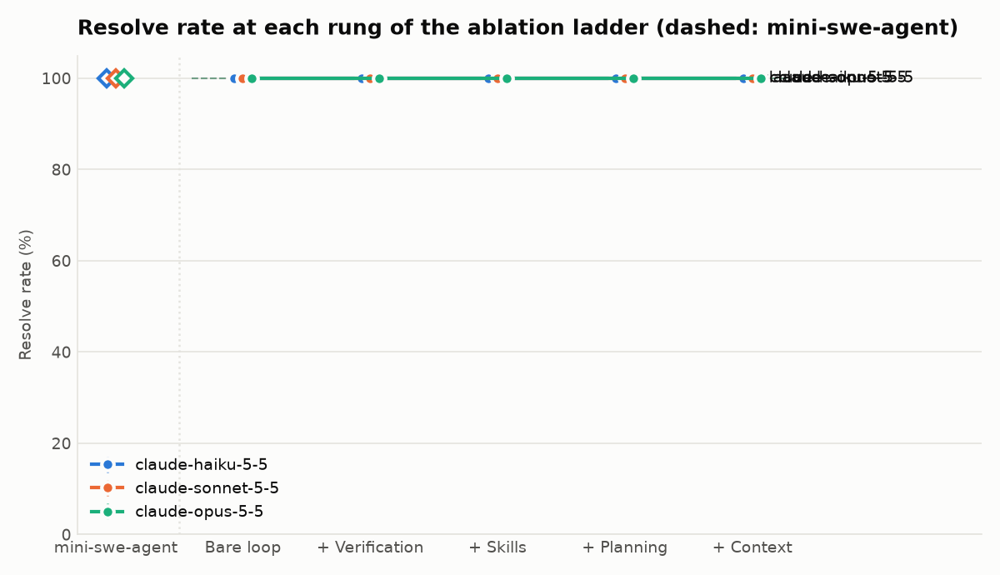
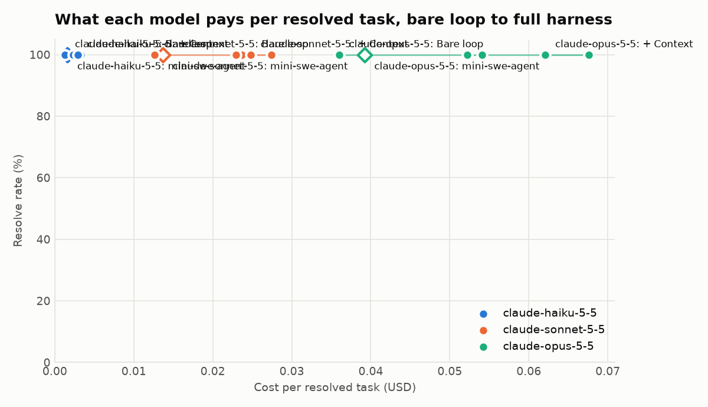

# Experiment: full

Resolve rate is the mean over runs, with the min to max across runs. Changes compare each rung with the rung before it for the same model.

| Config | Model | Resolve rate | Spread | Change | Cost per resolved | Change | Mean tokens | Flags | Skipped |
| --- | --- | --- | --- | --- | --- | --- | --- | --- | --- |
| mini-swe-agent | claude-haiku-5-5 | 100% | 100% to 100% |  | $0.002 |  | 23,371 | 0 | 0 |
| Bare loop | claude-haiku-5-5 | 100% | 100% to 100% |  | $0.001 |  | 12,743 | 0 | 0 |
| + Verification | claude-haiku-5-5 | 100% | 100% to 100% | +0 pts | $0.002 | +$0.001 | 25,748 | 0 | 0 |
| + Skills | claude-haiku-5-5 | 100% | 100% to 100% | +0 pts | $0.002 | -$0.000 | 24,799 | 0 | 0 |
| + Planning | claude-haiku-5-5 | 100% | 100% to 100% | +0 pts | $0.003 | +$0.001 | 42,418 | 0 | 0 |
| + Context | claude-haiku-5-5 | 100% | 100% to 100% | +0 pts | $0.003 | -$0.000 | 37,762 | 0 | 0 |
| mini-swe-agent | claude-sonnet-5-5 | 100% | 100% to 100% |  | $0.014 |  | 11,055 | 0 | 0 |
| Bare loop | claude-sonnet-5-5 | 100% | 100% to 100% |  | $0.013 |  | 8,136 | 0 | 0 |
| + Verification | claude-sonnet-5-5 | 100% | 100% to 100% | +0 pts | $0.024 | +$0.011 | 14,982 | 0 | 0 |
| + Skills | claude-sonnet-5-5 | 100% | 100% to 100% | +0 pts | $0.023 | -$0.001 | 15,779 | 0 | 0 |
| + Planning | claude-sonnet-5-5 | 100% | 100% to 100% | +0 pts | $0.027 | +$0.005 | 20,876 | 0 | 0 |
| + Context | claude-sonnet-5-5 | 100% | 100% to 100% | +0 pts | $0.025 | -$0.003 | 17,203 | 0 | 0 |
| mini-swe-agent | claude-opus-5-5 | 100% | 100% to 100% |  | $0.039 |  | 16,021 | 0 | 0 |
| Bare loop | claude-opus-5-5 | 100% | 100% to 100% |  | $0.036 |  | 11,153 | 0 | 0 |
| + Verification | claude-opus-5-5 | 100% | 100% to 100% | +0 pts | $0.054 | +$0.018 | 15,492 | 0 | 0 |
| + Skills | claude-opus-5-5 | 100% | 100% to 100% | +0 pts | $0.052 | -$0.002 | 16,181 | 0 | 0 |
| + Planning | claude-opus-5-5 | 100% | 100% to 100% | +0 pts | $0.068 | +$0.015 | 23,087 | 0 | 0 |
| + Context | claude-opus-5-5 | 100% | 100% to 100% | +0 pts | $0.062 | -$0.005 | 20,195 | 0 | 0 |

Full harness against the baseline (same model, tasks, sandbox, budgets and grading):

- claude-haiku-5-5: + Context 100% vs mini-swe-agent 100% (+0 pts); cost per resolved $0.003 vs $0.002.
- claude-sonnet-5-5: + Context 100% vs mini-swe-agent 100% (+0 pts); cost per resolved $0.025 vs $0.014.
- claude-opus-5-5: + Context 100% vs mini-swe-agent 100% (+0 pts); cost per resolved $0.062 vs $0.039.

Total: 540 task runs, $13.51. Task set: self self-v1 (c405b7cae2a3).

