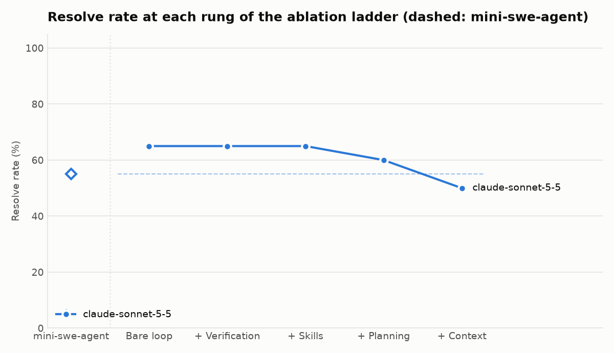
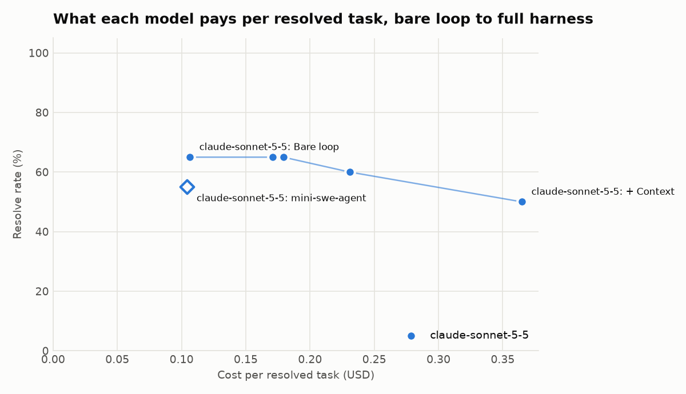

# Experiment: swebench-pilot

Resolve rate is the mean over runs, with the min to max across runs. Changes compare each rung with the rung before it for the same model.

| Config | Model | Resolve rate | Spread | Change | Cost per resolved | Change | Mean tokens | Flags | Skipped |
| --- | --- | --- | --- | --- | --- | --- | --- | --- | --- |
| mini-swe-agent | claude-sonnet-5-5 | 55% | 55% to 55% |  | $0.104 |  | 62,334 | 0 | 0 |
| Bare loop | claude-sonnet-5-5 | 65% | 65% to 65% |  | $0.106 |  | 84,169 | 0 | 0 |
| + Verification | claude-sonnet-5-5 | 65% | 65% to 65% | +0 pts | $0.171 | +$0.065 | 121,661 | 0 | 0 |
| + Skills | claude-sonnet-5-5 | 65% | 65% to 65% | +0 pts | $0.179 | +$0.008 | 141,849 | 0 | 0 |
| + Planning | claude-sonnet-5-5 | 60% | 60% to 60% | -5 pts | $0.231 | +$0.052 | 180,450 | 0 | 0 |
| + Context | claude-sonnet-5-5 | 50% | 50% to 50% | -10 pts | $0.365 | +$0.134 | 248,889 | 0 | 6 |

Full harness against the baseline (same model, tasks, sandbox, budgets and grading):

- claude-sonnet-5-5: + Context 50% vs mini-swe-agent 55% (-5 pts); cost per resolved $0.365 vs $0.104.

Total: 114 task runs, $12.41. Task set: swebench-live swebench-live-v1 (2a8455219a6d).

Some task runs were skipped because the API account failed (no credit or a bad key); they are left out of the rates, and those cells are incomplete and rerun next time.

